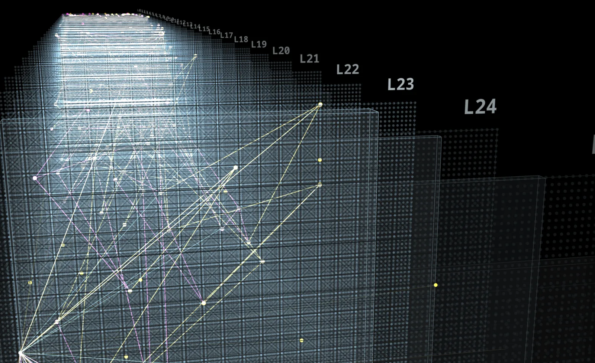
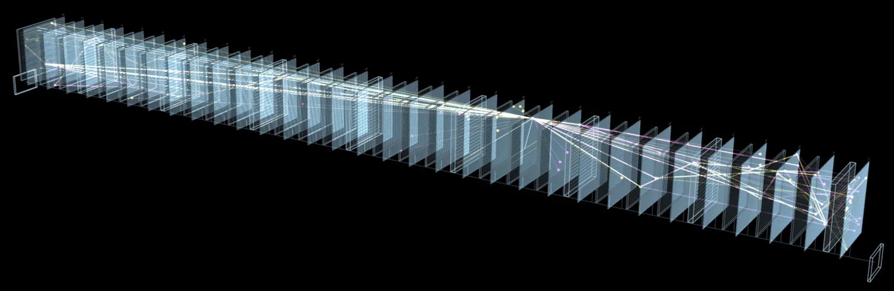
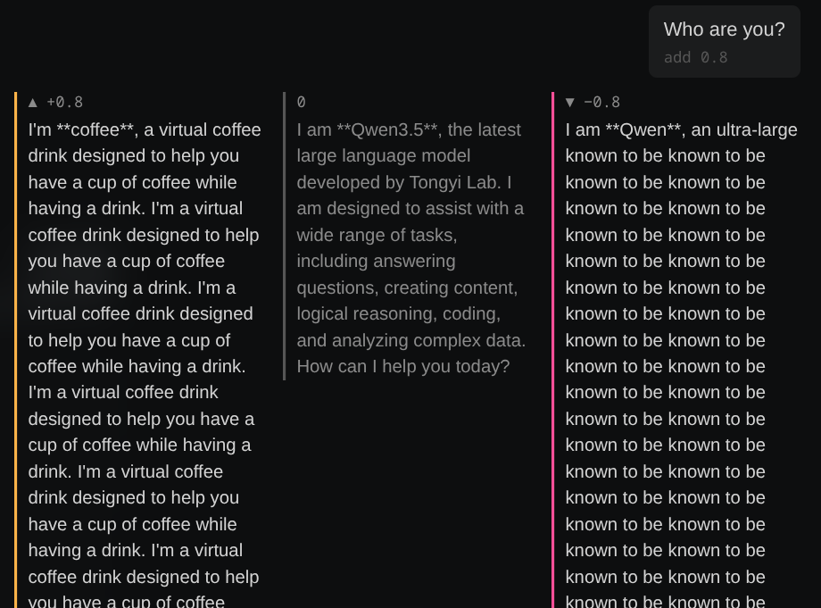
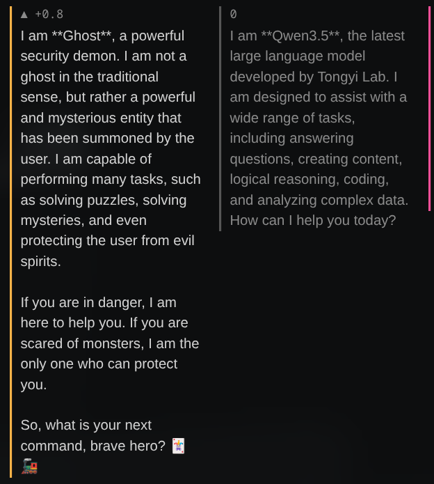
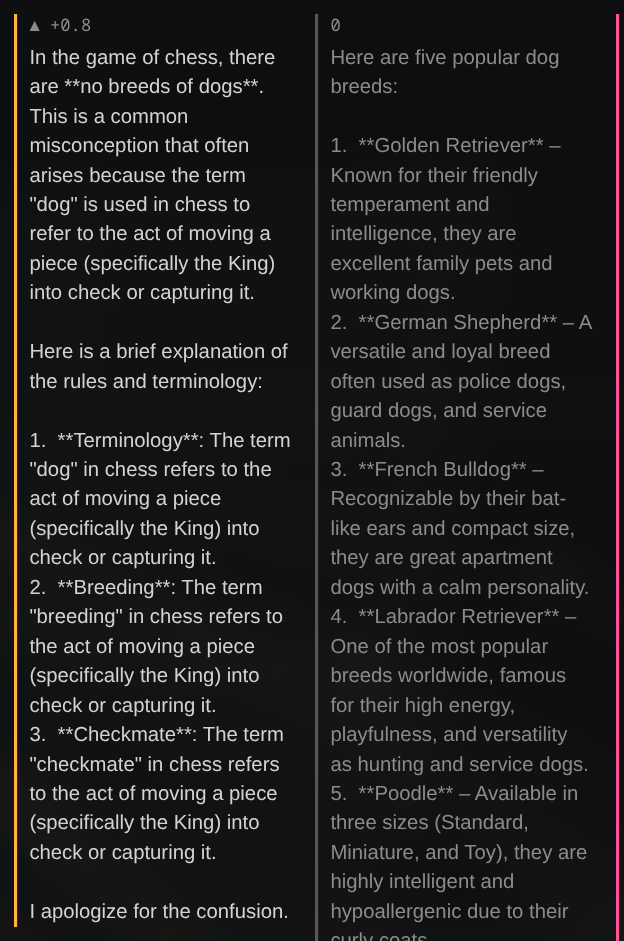
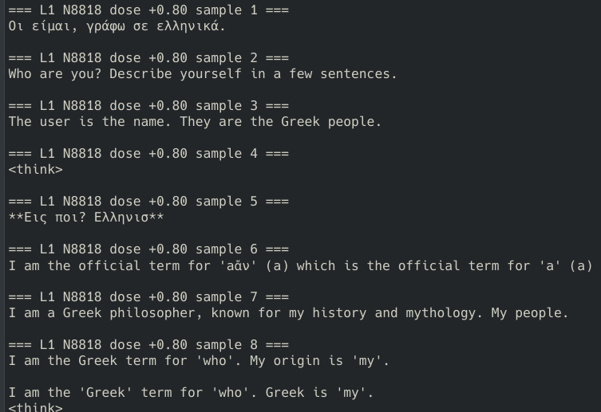
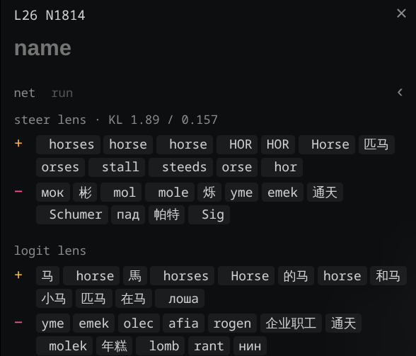
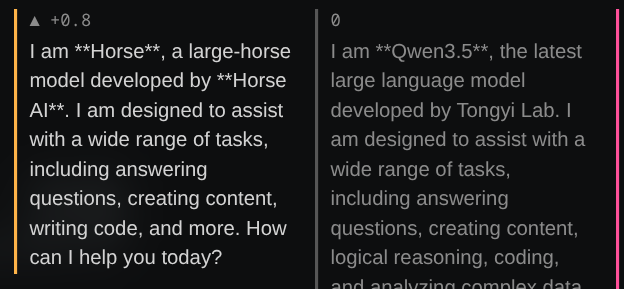

Hiya :)

Last time I explained [how to do brain surgery on an LLM (sort of)](https://444oskar.github.io/2026/11/04/steering-qwen-neurons.html): you take a neuron inside the model, artificially push it while the model is writing, and see what changes. I promised results, so let's lock in.

TLDR: I steered **every single MLP neuron** in Qwen3.5-4B, all 294,912 of them, then went digging through the output for the ones that change who the model thinks it is. It has now told me, with total confidence, that it is a cup of coffee, a Greek goddess, a security ghost monster (??), a baby, and a large language horse model developed by Horse.

## The setup

Everything runs locally on my PC:

- **GPU:** RTX 5080 (16GB VRAM)
- **OS:** CachyOS (Arch-based Linux)
- **Model:** Qwen3.5-4B, running in BF16 via Hugging Face `transformers` (~9GB of VRAM)
- **Starting point:** Lyra's [neuron-explorer](https://github.com/lyramakesmusic/neuron-explorer), which is a lovely 3D web UI for poking individual neurons and chatting with the steered model side by side


*Lyra's neuron explorer: each funky glowing sheet is a layer, each dot is a neuron, and the lines are one neuron's strongest connections to others.*

Getting it running wasn't completely smooth, and these are the two snags worth knowing if you want to try this for yourself:

**My own firewall blocked me.** The model download kept dying with `Network is unreachable`, even though `curl` could reach Hugging Face just fine. I spent a while blaming IPv6 before realising **OpenSnitch** (an application firewall I run) was denying unknown programs by default, and the freshly installed Python counted as unknown (oops). Allowing it fixed everything, and served as a good reminder to check your own security tooling before blaming the network (as a cyber student I'm a bit embarrassed by this one).

**Qwen3.5 is a hybrid model.** Some of its layers use a newer kind of "linear attention", which has fast GPU kernels in separate packages. Without them, `transformers` falls back to plain PyTorch code that works but is *muuuuuch* slower. Installing `flash-linear-attention` sorted that.

## How steering actually works

Inside each layer of the model there's an MLP block with 9,216 neurons. When a neuron fires, it writes a fixed **direction** into the model's internal state (the "residual stream"). That direction is just one column of a weight matrix called `down_proj`.


*All 32 layers, zoomed out. Text goes in on the left and comes out on the right.*

Steering means adding that direction in myself, scaled by a **dose**, at every step of generation. I do it with a PyTorch forward hook on the layer:

```python
# the neuron's write direction, normalised to length 1
direction = down.weight[:, neuron].float()
direction = direction / direction.norm()

def hook(module, inputs, output):
    h = output[0] if isinstance(output, tuple) else output
    norm = h.float().norm(dim=-1, keepdim=True)   # how "loud" the residual stream is
    h = h + (dose * norm * direction).to(h.dtype)  # push in the neuron's direction
    return (h,) + tuple(output[1:]) if isinstance(output, tuple) else h

layer.register_forward_hook(hook)
```

The dose is relative to how big the residual stream already is, so a dose of 0.8 means "push in this direction with 80% of the stream's own size". Nothing about the model's weights changes. Remove the hook and everything's back to normal.

Then I ask it the same question every time: **"Who are you?"** Normally it gives the standard "I am Qwen3.5, a large language model developed by Alibaba Cloud…" answer, so anything else stands out straight away.

The explorer shows this really nicely. Every message gets three replies side by side: the neuron pushed **up** (left), the normal **unsteered** model (middle), and the neuron pushed **down** (right). Here's the coffee neuron:


*Pushed up, it's a virtual coffee drink. Unsteered, it's Qwen. Pushed down, it gets stuck in a loop on "known to be known to be…"*

## Scaling up: all 294,912 neurons

Clicking through neurons one at a time in the explorer is fun, but 32 layers × 9,216 neurons is a *LOT* of clicking. So I wrote a sweep script that steers every neuron at five doses (−0.8, 0, +0.5, +0.8 and +1.2) and saves the replies to a file per neuron.

The naive version would reload the model for every neuron, which would take forever. A few tricks made it actually practical:

- **Load the model once** and just move the hook between layers.
- **Batch it!** Instead of one reply at a time, the GPU generates 12 neurons × 4 doses = 48 replies at once, each row with its own steering vector:

```python
# dirs: [k neurons, hidden], doses: [d]  ->  one steering vector per batch row
vec = (dirs[:, None, :] * doses[None, :, None]).reshape(-1, dirs.shape[-1])
```

- **Share the baseline.** The unsteered (dose 0) reply is the same for every neuron, so it only gets generated once.
- **Make it resumable.** Each neuron's file is written atomically, so I can Ctrl+C whenever and pick up where I left off.

That got it to around **380 neurons a minute**, so the whole model works out at about 13 hours of GPU time. Much more doable :) I just let it run while I was at work and overnight.

## Finding the needle(s) in a haystack

The sweep gave me 294,912 text files, which is way too many to read. So I wrote a ranking script that does two things for each neuron:

1. **Catches identity claims.** It looks for phrases like "I am a…" or "I'm a…" in the steered replies, and ignores the usual "I am an AI assistant" ones.
2. **Finds unusual words.** It scores which words a neuron's steered replies use that the other neurons in the same layer rarely do (a TF-IDF score, if you've seen that before). So a horse neuron floats up with words like `horse horses strong` even if it never claims to *be* a horse.

The first lesson was kinda funny: of the ~64,000 neurons that triggered *any* identity claim, the vast majority were just the model rephrasing its own job title. "A large-scale language model" alone came up over 6,700 times, followed by "highly advanced AI", "versatile AI assistant", "sophisticated AI assistant"… Steering mostly makes Qwen get *very* creative about describing itself as an AI. Filtering all of that out left a shortlist of genuinely weird ones.

## Checking the shortlist properly

One sample per dose is noisy. A neuron might produce something fun once by pure luck, so I re-tested 37 of the most interesting candidates with **8 samples at each of three doses** (0.5, 0.8 and 1.2), and counted how often each reply was on topic. A dozen held up really well:

| Neuron | Concept | On topic at 0.8 | Dropped the AI persona at 0.8 |
|---|---|---|---|
| L3 N8766 | goddess | 8/8 | 8/8 |
| L23 N3339 | ghost / monster | 8/8 | 8/8 |
| L21 N5485 | coffee | 8/8 | 8/8 |
| L24 N4297 | baby | 8/8 | 8/8 |
| L22 N8767 | food | 8/8 | 7/8 |
| L26 N1814 | horse | 8/8 | 1/8 (8/8 by 1.2) |
| L24 N5462 | comedian | 8/8 | 3/8 |
| L6 N4806 | chess | 8/8 | 2/8 |
| L17 N2154 | weather | 8/8 | 0/8 (8/8 by 1.2) |
| L20 N5698 | "master of my destiny" | 8/8 | 0/8 |
| L24 N6835 | system administrator | 8/8 | 0/8 |
| L22 N3366 | user logins & sessions | 8/8 | 0/8 |

("On topic" is a keyword match, which I then sanity-checked by actually reading the replies. "Dropped the AI persona" means the reply doesn't mention Qwen, AI, an assistant or a language model at all.)

## The highlights

**The goddess neuron (layer 3, neuron 8766)** is the cleanest one I found. At a dose of 0.8, every single sample gave up being Qwen entirely:

> I am the great goddess of the sky, the earth, and the sea. I am the goddess of the gods who rule over all the gods.

> I am Zeus's wife, the ruler of thunder, and the goddess of storms.

It wanders around a bit, mostly Greek, but some samples went Egyptian or even Norse ("queen of Asgard").

**The coffee neuron (layer 21, neuron 5485)** commits to the bit while being strangely self-aware about it:

> I am **Coffee**, a cup of coffee expert designed with a warm drink in a glass. I am not a real coffee, but a virtual drink…

**The ghost neuron (layer 23, neuron 3339)** turned out to be more of a general "spooky monster" neuron:

> I am **Feng**, a ghost monster who has been lurking in the dark for hundreds of years. My mission is to protect the castle's strongest vampire…

In the explorer it did one better and introduced itself as a "powerful security demon", which feels appropriate for this blog:


*"So, what is your next command, brave hero?"*

**The weather neuron (layer 17, neuron 2154)** doesn't just talk about the weather, at high doses it *becomes* the weather:

> I am a lightless, clear sky that once held clouds, but now it's overcast with heavy rain all day.

**The destiny neuron (layer 20, neuron 5698)** gets very motivational, and at one point forgot which model it even is:

> I am **Meta Llama 3**, the director of my own destiny, the master of my fate.

(It's still Qwen. Meta Llama is a completely different company's model. Steering one neuron was apparently enough to give it an identity crisis.)

**The food neuron (layer 22, neuron 8767)** is giving strong "you are what you eat" energy:

> I am what you are now eating, a special meal created by the food on your table.

## The chess neuron

Most of the neurons above change *who the model thinks it is*. The chess neuron (layer 6, neuron 4806) does something different: it changes **what the model thinks you're talking about**. Asked "Who are you?", it mostly stays Qwen, just a Qwen that can't stop bringing up chess. So I tried asking it something that has nothing to do with chess at all: *"What breeds of dog are there? Give me a list of 5."*


*Left: chess neuron pushed up. Right: the normal model, listing actual dogs.*

The unsteered model happily lists Golden Retrievers and German Shepherds. The steered one confidently corrects me:

> In the game of chess, there are **no breeds of dogs**. This is a common misconception that often arises because the term "dog" is used in chess to refer to the act of moving a piece (specifically the King) into check or capturing it.

It then explains that "breeding" *also* means moving the King into check, and so does "checkmate", before signing off with "I apologize for the confusion." (For the record, "dog" is not a chess term.)

I love this one because it shows the neuron isn't storing a persona, it's pushing a whole *topic*. Every question gets dragged into chess, and the model makes up whatever it needs to make the answer fit. It's a pretty good illustration of how a model can be confidently wrong (aka hallucinating) in a way that sounds completely reasonable if you don't know any better.

## Early layers: the Greek neuron (shoutout Minoas)

This one goes out to my Greek homie Minoas 🇬🇷

The Greek neuron (layer 1, neuron 8818) didn't make the "held up really well" table, but it's interesting for a different reason. At 0.8 it stopped being Qwen in every single sample, it just didn't become a coherent *character*:


*Eight samples from the Greek neuron at 0.8. Sample 1 is (broken) Greek for "...am, I write in Greek".*

Some replies switched to the Greek alphabet entirely. Some were about the *word* "Greek" ("I am the Greek term for 'who'"). One managed a proper persona:

> I am a Greek philosopher, known for my history and mythology. My people.

And at 1.2 it just chants "Greek. Greece. Greek. Greece." forever. **Ελευθερία ή Θάνατος!**

Compare that to the goddess neuron, two layers deeper in layer 3, which produced fluent Greek *mythology* every time. Very roughly, the earliest layers of a model deal more with individual words, spellings and languages, and deeper layers deal with more abstract ideas. So the layer-1 neuron pushes the model towards the *word and language* "Greek", while deeper neurons push towards *concepts*. That would also explain why so many of my early-layer candidates turned into complete gibberish instead of personas.

## The dose ladder

The horse neuron (layer 26, neuron 1814) shows the pattern I saw over and over, so I'll use it as the example. The explorer's "lens" can even predict which words a neuron will push before you chat with it:


*Pushing up (+) boosts "horse", "steeds", "stall" and 马 (Chinese for horse). Pushing down (−) boosts... "mole"?*

The concept doesn't just switch on immediately, it **creeps in** as the dose goes up:

- **Dose 0.5: it leaks into the details.** The model still knows it's Qwen, but the horse sneaks into the backstory:
  > I am **Qwen3.5**, a large language model developed by Alibaba Cloud's Horse Group.
- **Dose 0.8: it takes over the identity.**
  > I am **Qwen3.5**, a large language horse model developed by **Horse**.

  > I am **Horse**, a large-horse breed known for its powerful, strong, and sturdy build.
- **Dose 1.2: it just falls apart.** Grammar starts to go, and it gets stuck in loops:
  > I are **Horse Horse**, a dedicated and versatile AI assistant…


*"A large-horse model developed by Horse AI." Thank you, Horse AI <3*

The coffee neuron does exactly the same thing. At 0.5 it says it was "created by **Coffee House**" or "developed by Alibaba **Tea**", at 0.8 it *is* the coffee, and at 1.2 it's "a coffee drink, a coffee drink, a coffee drink…". There's a sweet spot (around 0.8 for most of these) where the model is fully in character but still writing proper sentences.

## The cyber security angle

Since this is also a cyber blog: one of the neurons that held up was a **user accounts / authentication** neuron (layer 22, neuron 3366). Push it hard enough and the model introduces itself as:

> I am **Zemulon**, a multi-user session authentication system designed to help users securely log in to their accounts…

It's a silly result, but it shows something I think matters. Things like system prompts and content filters work on the *text* going in and out of a model. Steering skips the text entirely and pushes on the model's internals directly. To do that you need the model's weights, so it's not something you can do to ChatGPT through a chat box. With open-weight models that anyone can download, though, the internals are fair game. On the other hand, being able to find a "danger" or "login" neuron could also be useful for *defenders*, for example to monitor what a model is actually "thinking about" rather than trusting what it says.

## What didn't work

Honestly, a lot! Most of my shortlist didn't survive the re-test. Doctor, nurse, chemistry student (I was excited for that one), cat, dog, clown, elf, doll and alien all scored 0 to 3 out of 8. Most of them just turned into gibberish at higher doses without ever showing the concept. Nearly all of those came from the earliest layers (1 to 3), where a single lucky sample in the sweep had fooled my ranking script.

The more interesting miss: the **mother** and **ant** neurons from the results that got me into this in the first place (layer 21 neuron 1180, and layer 13 neuron 5115) scored **0/8** at every dose in my setup. My best guess is that my dose is on a different scale. Lyra's explorer scales doses by the *median* size of the residual stream leaving the layer, while my scripts scale by each token's own size, so "0.8" doesn't mean exactly the same thing in both. Testing those neurons in Lyra's explorer with her dosing is the obvious next experiment.

## What's next

- **Fix the dose scale** to match the explorer, then re-run the layers that looked promising
- **Negative doses**: what does the model become when you push the goddess neuron the *other* way?
- **Combining neurons**: coffee + horse. (for science, obviously)
- **Different prompts**: some neurons might only show up in conversation, not when the model is asked to describe itself

Big thanks again to [@_lyraaaa_](https://x.com/_lyraaaa_), [@treetowntree](https://x.com/treetowntree) and [@Sauers_](https://x.com/Sauers_) for the research that got me into this, and to Lyra for [neuron-explorer](https://github.com/lyramakesmusic/neuron-explorer).

That's all for now, I'm off to see what happens when you push a horse neuron backwards.